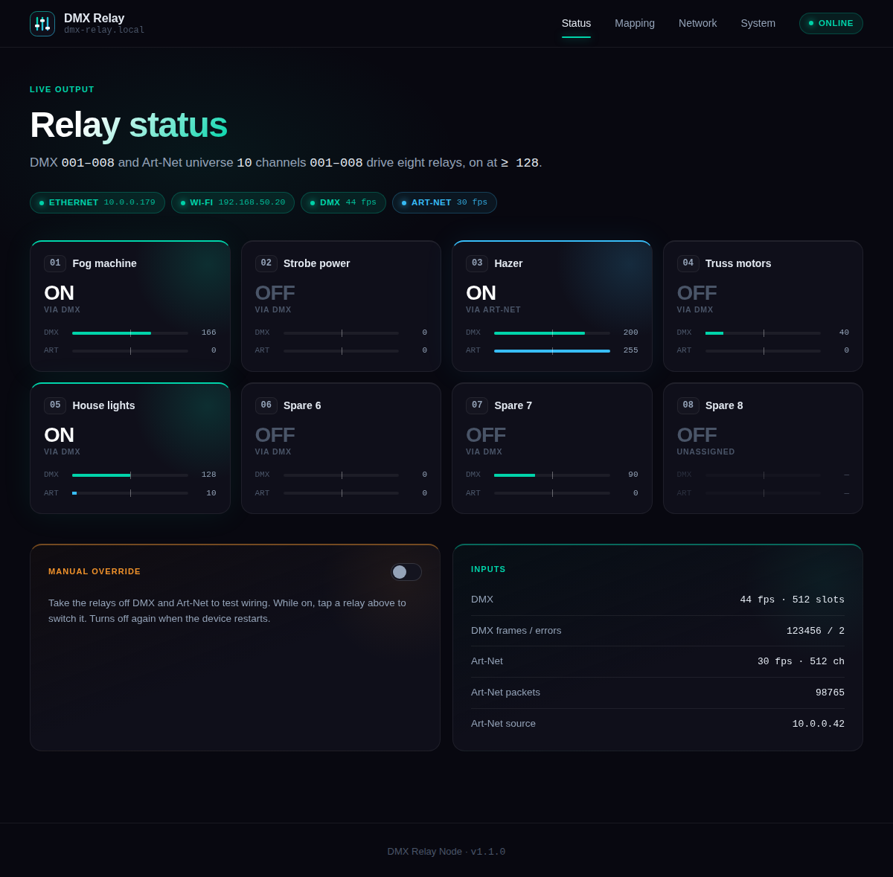
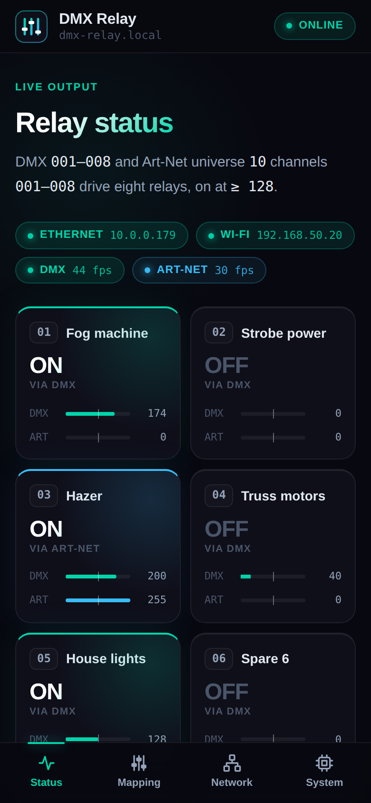
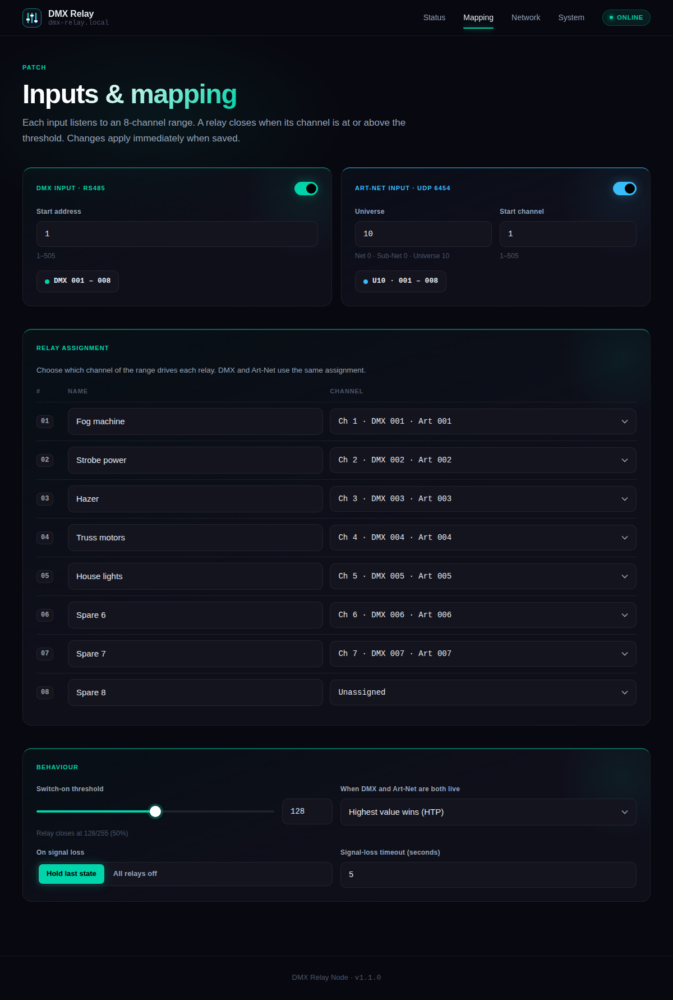
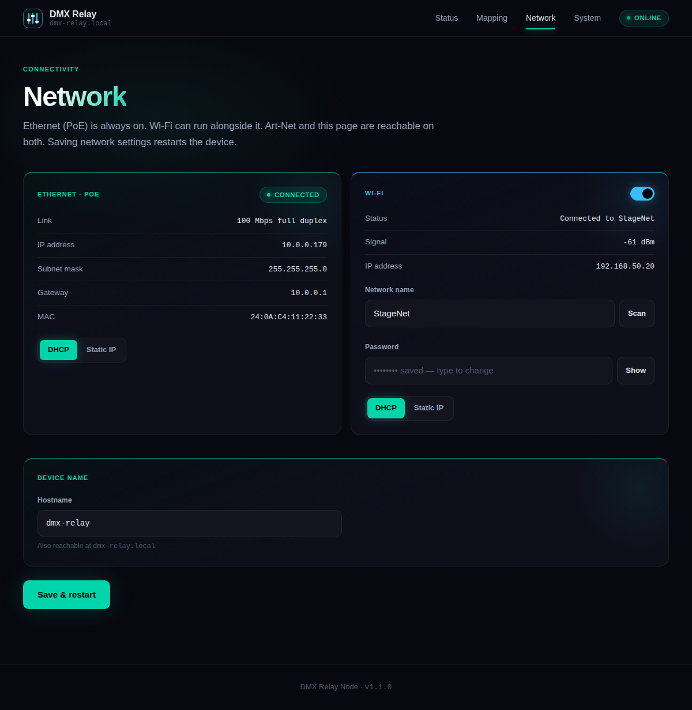
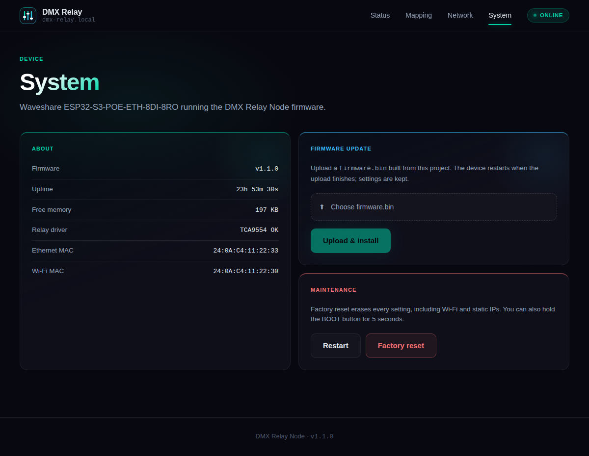

# DMX Relay Node

DMX512 + Art-Net controlled 8-relay firmware for the Waveshare
[ESP32-S3-POE-ETH-8DI-8RO](https://www.waveshare.com/wiki/ESP32-S3-ETH-8DI-8RO).

 

- PoE Ethernet (DHCP or static) + optional Wi-Fi
- DMX on RS485 and Art-Net on UDP 6454, each mapped to an 8-channel range
- Live status, manual relay test, web firmware update
- `http://dmx-relay.local/`

## Install

| | |
|---|---|
| **Update a running device** | Web UI → **System → Firmware update** → `firmware/dmx-relay-1.1.0.bin` |
| | or `curl -F "firmware=@firmware/dmx-relay-1.1.0.bin" http://<ip>/api/update` |
| **First flash / recovery (USB)** | `esptool --chip esp32s3 write-flash 0x0 firmware/dmx-relay-1.1.0-factory.bin` |
| **Build from source** | VS Code + PlatformIO → **Upload** (→), or `pio run -t upload` |
| **Animatronic build** | Same, with `firmware/animatronic-1.1.0.bin` / `-factory.bin`, or `pio run -e animatronic -t upload` |

USB won't connect? Hold **BOOT**, tap **RESET**, release BOOT.

## Setup

1. Power via PoE (802.3af), USB-C or 7–36 V.
2. Browse to `http://dmx-relay.local/` or the DHCP address.
3. No network after 20 s → hotspot **`dmx-relay-XXXX`**, password **`dmxrelay`**, page at `192.168.4.1`.

Factory reset: hold **BOOT** 5 s.

## Pages

**Mapping:** DMX start address, Art-Net universe + start channel, relay → channel assignment, threshold, merge, signal loss.

**Network:** Ethernet DHCP/static, Wi-Fi join + scan, hostname. Saving restarts the device.

**System:** firmware info and update, restart, factory reset.

**Log:** errors, warnings and events since boot (network, OTA, relay driver, USB audio, reset reason), live, with
level filter and download. The USB speaker's bring-up is logged step by step, so start there when sound doesn't work.

## Behaviour

- Relay **on** when its channel ≥ threshold (default 128).
- Both inputs live → **HTP** (default), **LTP**, **Prefer DMX** or **Prefer Art-Net**.
- Signal lost (default 5 s) → **hold** (default) or **all off**. Relays start off at power-up.
- **Number keys 1–8** on the Status page: holding one acts like that input channel at full (released = 0), so
  whatever is mapped to it triggers, even with no DMX connected. In manual override a press toggles that relay.
- Art-Net universe = 15-bit port-address: `10` = Net 0 · Sub-Net 0 · Uni 10.

Test Art-Net: `python3 tools/artnet_test.py <ip> --universe 10`

## Animatronic build

A second build of the same source (`pio run -e animatronic`) turns the board into an animatronic controller. It
shares the settings storage, so switching builds keeps the network and DMX setup.

| Hardware | Use |
|---|---|
| Relays 1 + 2 | H-bridge for a reversing DC motor: each **COM** to a motor lead, **NO** to +V, **NC** to GND |
| Relay 3 | Eyes / lights |
| Relays 4–8 | Ordinary DMX relays |
| DI1 | Center switch (closes when the head faces forward), dry contact between **DI1** and **DGND** |
| USB-C | USB speaker for sound effects (USB Audio Class 1.0) |

- **Status:** Left / Stop / Right (keys **← ↓ →**), Eyes (**↑**), Center (**Space**) drives back to center,
  Find center (**H**) re-homes, Random (**R**) with its interval slider, ignore travel limit, 4 sound slots with
  upload, volume.
- **Random:** turns the head to random points within 80% of the max swing (now and then straight ahead), each
  turn 0.5–1.5× the interval after the last one finishes (slider 1–30 s, default 6 s). The eyes stay manual. It homes first
  if needed, waits for a move to finish, pauses in manual override, and Stop turns it off. Saved with the settings.
- **Homing:** at power-up (2 s in, can be turned off) or on **Find center**, the head swings left, then right, each
  swing 250 ms further from where it started, up to the **max swing** (default 2.5 s), until the center switch
  closes. If it's not found either way the head goes back to where it started. The last known position is saved,
  so after a restart homing first runs straight toward center, and searches the other side if it isn't there.
- **Motor:** once homed, the head's position is tracked by run time and re-zeroed every time it passes center; a
  move stops at the max swing either side of center, and that direction stays blocked until it moves back. Before
  homing, a move stops after the max swing time. Direction changes pass through off and wait the reverse delay
  (default 500 ms). Relays 1 and 2 are never on together.
- **Mapping:** the 8 channels each drive one output (motor left/right or a single direction channel with center +
  dead zone, eyes, sound 1–4, volume, relays 4–8). Choosing an output that's in use moves it.
- **Sounds:** uploads (WAV, MP3, …) are converted in the browser to mono 24 kHz and stored on the device (~70 s
  total). A channel rising above the threshold plays its sound.
- **USB audio** (System page) makes the USB-C port a host, so USB serial stops working while it's on. The board
  doesn't put 5 V on that port, so the speaker needs 5 V fed onto VBUS, e.g. a USB-C OTG adapter with a power input.
  A powered hub alone doesn't work: hubs only connect when they see 5 V from the host. Flash over USB by holding **BOOT**.

Extra API: `POST /api/anim` `{"motor":"left"|"right"|"stop"}`, `{"center":true}`, `{"home":true}`, `{"eyes":true}`, `{"override":true}` ·
`POST /api/sfx` `{"play":0}`, `{"stop":0}`, `{"delete":0}` · `POST /api/sfx/upload?slot=1&name=…` (multipart WAV).

The USB Audio Class driver is Espressif's `usb_host_uac`, vendored in `lib/usb_host_uac` (Apache-2.0).

## Status LED

| Teal | Dim blue | Flashing blue | Amber | Orange | Flashing red |
|---|---|---|---|---|---|
| Receiving | Online, idle | Setup hotspot | No network | Manual override | Relay driver fault |

## Wiring

RS485 **A** = DMX+ (XLR 3), **B** = DMX− (XLR 2). Fit the 120 Ω jumper on the last device. Receive only, no RDM.

## API

| | |
|---|---|
| `GET /api/status` | Full status |
| `GET /api/events` | Live updates (SSE) |
| `GET/POST /api/config` | Settings (partial JSON on POST) |
| `POST /api/relays` | `{"manual":true}`, `{"index":0,"on":true}`, `{"all":false}` |
| `POST /api/keys` | `{"keys":5}`: channels held at full, bit 0 = channel 1; repeat within 1.5 s or it lapses |
| `GET /api/scan` | Wi-Fi scan |
| `GET /api/log?after=N` | Log entries newer than N · `POST /api/log` `{"clear":true}` |
| `POST /api/update` | Firmware upload |
| `POST /api/reboot`, `/api/factory-reset` | |

No authentication. Keep it on a trusted network.
